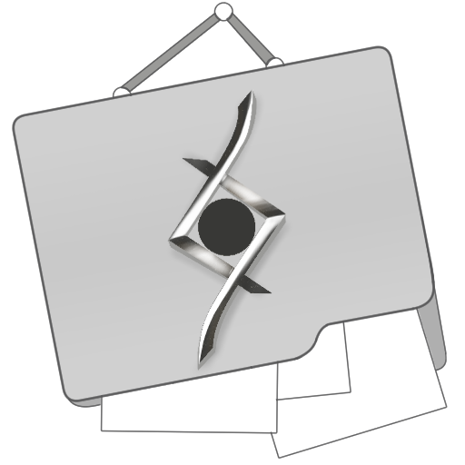

---
hide:
  - navigation  # Hides the left sidebar on the homepage (Cleaner)
  - toc
  - feedback
search:
  exclude: true 

---

{ width="200" }

# OpenReferenceFolder

 

### A file manager built for creatives

Organize references, customize workflows, and view what matters.

 

[Download Now](https://github.com/JThoumas/OpenReferenceFolder/releases){ .md-button .md-button--primary }
[User Manual](manual/index.md){ .md-button }

 

---

## Download and Installation

Please read the [User Manual](manual/index.md) and then visit the [Github Releases](https://github.com/JThoumas/OpenReferenceFolder/releases) to download. Refer to the [Quick Start](manual) guide in the User Manual for an optimal experience.

---

## Description

OpenReferenceFolder (ORF) is an open source, cross-platform, specialized desktop file manager. The goal of OpenReferenceFolder is to be a highly flexible reference tool in an easily configurable graphical user interface that complements your existing workspace.

ORF lets you organize your files in **virtual folders**. A virtual folder points to files and folders that already exist on your drive. It does not copy them or use extra disk space. You can move, rename and delete files from inside ORF.

- Browse folders as a grid or a list with thumbnails, filter out files that are not references, and open files in the app you choose.
- Arrange the interface with docking panels, tabs and floating windows. ORF saves your layout, including windows on other monitors, as a workspace.
- Drag images in from a web browser. ORF saves them into the real folder you drop them on, or into your assets folder.

---

## Core Features

- [__**Reference Viewing**__](./manual/plugins/pureview.md)

    ---

    Turn ORF into a reference control panel with PureView.

- [__**Plugins**__](./plugins/index.md)

    ---

    Optional, installable components that provide additional functionality to your ORF.

- [__**Modular Design**__](./manual/introduction/docking-panels.md)
  
    ---

    Customize your workspace with docking panels and floating windows.

- [__**File Management**__](./manual/introduction/file-operations.md)

    ---

    Organize files and folders in your ORF with basic file explorer functionality.

- [__**Customizability**__](./manual/preferences/index.md)

    ---

    Customize and create color scheme presets for your ORF.

- [__**Project File Previews**__](./manual/introduction/supported-files.md)

    ---

    Previews for project files such as .psd, .kra, .clip and .blend.
  

---

## Acknowledgements

### Open-source Libraries

- OpenGL Extension Loader: [glad](https://glad.dav1d.de/) (MIT)
- Window and Input Library: [GLFW](https://www.glfw.org/) (zlib)
- Font Rasterizer: [FreeType](https://freetype.org/) (FreeType License or GPLv2)
- Single-File Image Loader: [STB libraries (stb_image.h)](https://github.com/nothings/stb) (MIT or public domain)
- JPEG Codec: [libjpeg-turbo](https://libjpeg-turbo.org/) (IJG, BSD-3-Clause and zlib)
- Embedded Database: [SQLite](https://www.sqlite.org/) (public domain)
- JSON Library: [nlohmann/json](https://github.com/nlohmann/json) (MIT)
- Native File Dialogs: [nativefiledialog-extended](https://github.com/btzy/nativefiledialog-extended) (zlib)
- Zip Archives: [miniz](https://github.com/richgel999/miniz) (MIT)
- Icons: [Material Design Icons](https://pictogrammers.com/library/mdi/) (Apache-2.0)
- SVG Parser, SVG plugin: [NanoSVG](https://github.com/memononen/nanosvg) (zlib)
- C++17 Filesystem Library: [std::filesystem](https://en.cppreference.com/w/cpp/filesystem)

### Documentation
- Made with <https://zensical.org>
- GitHub contributors image: [contrib.rocks](https://contrib.rocks)

### Inspiration

- [OpenTabletDriver](https://opentabletdriver.net/): If you own a pen tablet, this is the tablet driver to use.
- [Clip Studio Paint](https://www.clipstudio.net/): Exemplary UI/UX design ([palettes](https://help.clip-studio.com/en-us/manual_en/690_interface/Palettes.htm?rhhlterm=dock&rhsearch=dock)) curated for all types of individuals using digital art as a medium to create art.
- [qView](https://interversehq.com/qview/): A simple yet powerful image viewer with a focus on minimalism. 

### Contributors

Thank you to all contributors for supporting the development of ORF - your support helps creatives create even more!

---

## Disclaimer

- This software is open source under the [AGPL-3.0 License](https://github.com/JThoumas/OpenReferenceFolder/blob/main/LICENSE).
- The software's logo is NOT licensed under AGPL 3.0. The artist [zenthusa](https://x.com/zenthusa) reserves all rights. The logo must not be used without authorization, even with AGPL 3.0 license claims, and must not be used for any commercial purposes without authorization.
- This software is open source and free, intended only for learning and communication purposes. The software is provided to You "AS IS" and "AS AVAILABLE" and with all faults and defects without warranty of any kind; the authors and contributors shall bear no liability for any damages or consequences resulting from the use of this software.

---

  

    <strong>OpenReferenceFolder</strong> is licensed under the <a href="https://github.com/JThoumas/OpenReferenceFolder/blob/main/LICENSE">AGPL-3.0 License</a>.
  

